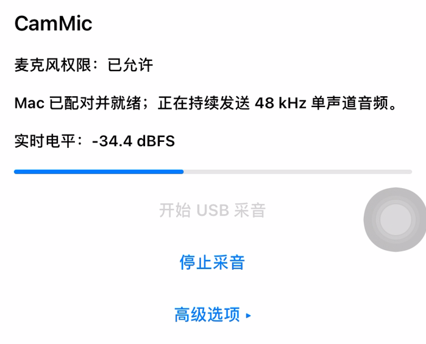
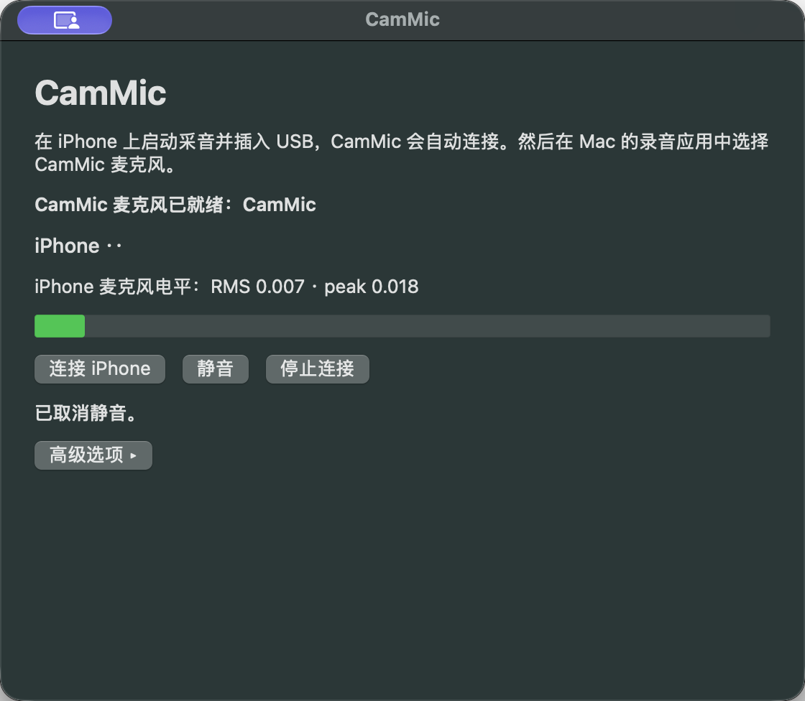

# CamMic

**Turn an old iPhone into a Mac system microphone.** Start capture on iPhone, plug in USB, then select **CamMic** in QuickTime or another recording app.

CamMic is free and open source. It supports **iOS 14.0+** and **macOS 13.0+ on Apple silicon**. USB connects automatically, with no CamMic pairing code. Active capture can continue while the iPhone is locked; phone calls and other apps that take over the microphone can interrupt it. **CamMic currently provides a microphone only; camera support is paused.**

> iOS 14.0 and macOS 13.0 are minimum deployment versions, not a claim that every supported device and OS release has been tested. See the [0.6.0 beta validation record](docs/releases/0.6.0-beta1.md) for the devices checked for this candidate.

## See CamMic running

These genuine screenshots show CamMic during a live USB session on an iPhone XR and a Mac. The iPhone image is cropped from a screen recording; its AssistiveTouch control is part of the original screen. The Mac screenshot masks the last four digits of the phone identifier. See the [candidate validation record](docs/releases/0.6.0-beta1.md) for device details and remaining **NOT_VERIFIED** checks.

  
  

## Get the test build

Download the three files from the [CamMic v0.6.0 Beta 1 release](https://github.com/YYKX682436/CamMic/releases/tag/v0.6.0-beta1):

- `CamMic-iOS14-unsigned.ipa`
- `CamMic-macOS-arm64.zip`
- `SHA256SUMS`

The Mac ZIP contains one main installer, optional repair and uninstall tools, the matching source archive, and license notices. The Mac app and installer are unsigned and not notarized. The IPA is also unsigned and needs TrollStore or your own signing method. No signing service or certificate is included.

## Use it

1. Install CamMic on iPhone and Mac. On Mac, open `CamMic-Installer.pkg` from the ZIP. On iPhone, install the IPA with your existing signing method.
2. Open CamMic on iPhone and tap **Start USB Capture**.
3. Connect the iPhone to the Mac with USB. CamMic discovers it automatically; approve Apple's trust prompt if it appears.
4. In QuickTime Player, choose **File → New Audio Recording**, select **CamMic** from the input menu, and record.

QuickTime may ask for microphone permission. Choosing CamMic in a recording app does not change the Mac's speaker output. For install, update, troubleshooting, and removal steps, see the [Chinese quick guide](docs/安装与使用.md).

## Project and license

CamMic's integrated app and driver are distributed under **GPL-3.0**. Original CamMic source retains its MIT notice; bundled USBMux libraries use LGPL-2.1-or-later. The Mac ZIP includes the matching complete source and notices. Read the [third-party notices](LICENSES/THIRD_PARTY_NOTICES.md), [development notes](docs/development.md), or [release notes](docs/releases/0.6.0-beta1.md).
